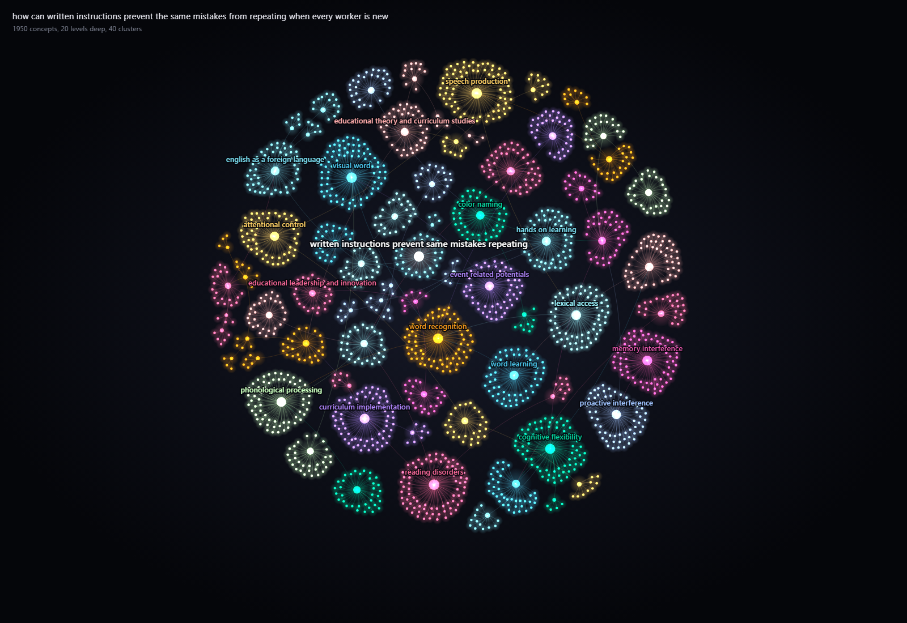

<div align="center">


# Eonrise

Finds the research fields that already solved your problem under another name.

[](https://github.com/Superstos/Eonrise/actions/workflows/ci.yml)
[](pyproject.toml)
[](LICENSE)
[](pyproject.toml)

[Features](#features) · [How it works](#how-it-works) · [Install](#install) · [Examples](#examples) · [FAQ](#faq) · [Docs](#docs)

<code>eonrise --demo --out output</code>

</div>

> **Using a web chat that cannot run code?** Paste this repo link and ask for what you want; the
> assistant should follow [docs/WITHOUT-CODE.md](https://github.com/Superstos/Eonrise/blob/main/docs/WITHOUT-CODE.md) and do the method by hand.

A problem that feels new in my field is often an old one somewhere else. Someone in law, medicine
or materials science has usually studied it for years, under words I would never think to search
for. Eonrise takes a question in plain language, searches up to six scholarly sources, and returns a
short brief: what the literature says about the question, what it admits it cannot do, and which
distant fields share the same shape of problem.

## Features

| You give it | You get back | You need |
| --- | --- | --- |
| A question in plain words | A brief with the mechanisms, measurements, failure modes, methods and neighboring fields the papers support | Internet access; no API key |
| The same question | Papers from distant fields that share the question's shape, plus searches to take into those fields | Nothing extra |
| Papers you gathered yourself (`--bundle`) | The same brief, fully offline | A JSON file, format in [docs/USAGE.md](docs/USAGE.md) |
| Repeated runs over weeks | A local paper store, searched before the APIs, and learned cross-field synonyms | Disk space under `~/.cache/eonrise/` |
| A script or another tool | `research_map.json` and `graph.json` with every term, paper and edge | Nothing extra |

Every term in the brief comes from a paper's title, abstract or keywords. When the papers do
not support part of the map, that part stays empty and the brief says so.

## How it works

Each run grows a map of concepts around your question: broader fields above it, related
fields beside it, narrower ones below, each branching again. Concepts backed by the same
papers are linked too. This is the [written instructions](examples/written-instructions-new-workers.md)
question run with `--max-depth 30 --max-nodes 2000`: 1,950 concepts, 20 levels deep. Click the
picture for the [live map](https://superstos.github.io/Eonrise/demo/), where you can hover,
search and switch links and colours. [`tools/graph_view.py`](tools/graph_view.py) builds both
from any run's `research_map.json`.

<a href="https://superstos.github.io/Eonrise/demo/"></a>

1. The question becomes one root topic, and every later search stays tied to it.
2. Each round searches the scholarly sources and drops papers about something else.
3. Terms, relations and stated limitations come from titles and abstracts. Each term joins
   the map as a parent, sibling or child of the root.
4. Empty parts of the map send targeted searches back to step 2, up to `--max-rounds`.
5. Papers from far fields that share the question's terms are kept apart and ranked. They are
   the point of the tool.
6. The run writes the brief, the map and the graph, and says how much of the reachable
   literature it saw, so a thin map reads as unfinished.

## Install

Eonrise needs Python 3.11 or newer and nothing else.

```bash
pip install eonrise
eonrise --demo --out output
```

The demo runs offline on a sample of 99 papers about finding analogous solutions in distant
fields. It writes the brief to `output/report.md`, with four other output files, in about a second,
and keeps no cache or stores.

Then ask your own question:

```bash
eonrise "how can written instructions prevent the same mistakes from repeating when every worker is new" --out output
```

To ask one problem from several angles, put one question per line in a file and run
`eonrise --angles questions.txt --out output`; `output/angles.md` shows what each angle
found that the others missed.

Four sources run by default, with no key. Semantic Scholar and CORE join when you give their
free key; [docs/USAGE.md](docs/USAGE.md) lists the environment variables.

| Source | Access |
| --- | --- |
| Crossref | keyless |
| OpenAlex | keyless, optional API key |
| Europe PMC | keyless |
| DOAJ | keyless |
| Semantic Scholar | free API key, or `--providers` |
| CORE | free API key, or `--providers` |

### With an AI agent

Small models tend to treat papers from distant fields as noise, which throws away the point of
Eonrise. The Eonrise skill teaches an agent to run it, read the brief, and turn each distant
paper into a concrete idea. In Claude Code:

```text
/plugin marketplace add Superstos/Eonrise
/plugin install eonrise@eonrise
```

In Codex, the same marketplace works:

```text
codex plugin marketplace add https://github.com/Superstos/Eonrise
codex plugin add eonrise@eonrise
```

Other agents can read [`plugin/skills/eonrise/SKILL.md`](plugin/skills/eonrise/SKILL.md)
directly. [`tools/agent_check.py`](tools/agent_check.py) measures the difference; on Haiku the
skill raised the distant fields used per answer from 1.6 to 2.8 (5 runs each).

## Tech stack and why

- **Python standard library only.** A research tool should install anywhere in one step, and
  zero dependencies means nothing to break, audit or pin.
- **Open scholarly APIs.** Crossref, OpenAlex and Europe PMC cover most fields for free and
  return abstracts and topic hierarchies, which is where the cross-field links come from.
- **JSON and JSONL files on disk.** The paper store and the synonym graph are plain files you
  can read, copy or delete, with no database to run.

## Architecture

| Path | What it holds |
| --- | --- |
| `eonrise/cli.py` | Command-line flags, stores and the printed summary |
| `eonrise/engine.py` | The search loop: plan queries, fetch, filter, read, repair gaps |
| `eonrise/providers.py` | One client per scholarly source, plus offline bundles and the HTTP cache |
| `eonrise/evidence.py` | Papers in, grounded and ranked terms out |
| `eonrise/distant_fields.py` | Distant papers that share the question's shape, ranked |
| `eonrise/equivalence.py` | Learned synonyms across fields, used to widen later searches |
| `eonrise/literature_coverage.py` | How much of the reachable literature a run has seen |
| `eonrise/paper_store.py` | Every paper seen so far, so later runs start rich |
| `eonrise/scheduling.py` | Which source to call next, and which are rate limited |
| `eonrise/report.py` | The brief, the full report and the JSON files |
| `tests/`, `benchmarks/` | Unit tests, byte-for-byte output snapshots, and quality gates |

## Examples

These are real runs, copied unedited into [examples/](examples/).

| Question | What it found in other fields |
| --- | --- |
| [How can written instructions prevent the same mistakes from repeating when every worker is new?](examples/written-instructions-new-workers.md) | Jury instructions: courts test which wording of a one-time instruction changes what new jurors decide. That is a ready method for testing onboarding docs. Also nursing training on clinical mistakes. |
| [Why do rules and plans keep growing in scope without being finished or removed?](examples/plans-that-keep-growing.md) | Management: *Corporate Planning: An Executive Viewpoint* (1981). Urban design: *Cinema as a form of composition* (2021). |
| [How can a system retrieve analogous solutions from distant research fields?](examples/demo-analogous-solutions.md) | Link prediction in knowledge networks, from machine learning. This is the `--demo` run. |

What it is good for:

- Before designing something, to see which field already measured the failure you are about to hit.
- When searches in your own field keep returning the same ten papers.
- To find the words another field uses, so the next search reaches its literature.
- As the research step for an AI coding agent: `research_map.json` gives it sources it can cite.

## FAQ

<details><summary><strong>Is the distant-field list just noise?</strong></summary>

It is the main output. A paper from another field shows up because it shares the question's
terms and topic structure. Read each one as "their solution, our version": what did they solve
that has the same shape as my problem? Some will not map, and that is worth knowing too.

</details>

<details><summary><strong>Does it read full papers?</strong></summary>

No. It works from titles, abstracts, keywords and topic data returned by the sources. Fields
whose abstracts are short or missing produce thinner maps.

</details>

<details><summary><strong>Why did my run end with status "failed" and exit code 2?</strong></summary>

No source returned papers about the question, often because a source timed out or rate
limited the run. The brief names the sources that failed. Try again later, add a free API key,
or pick sources with `--providers`.

</details>

<details><summary><strong>What does it save on my machine?</strong></summary>

Cached API responses, a paper store, learned synonyms, a run log and source limits, all under
`~/.cache/eonrise/`. [docs/USAGE.md](docs/USAGE.md) lists each file and the flag that turns it
off. `--demo` saves nothing.

</details>

<details><summary><strong>Where are the limits?</strong></summary>

The topic filter still leans on shared words, so an ambiguous question lets unrelated papers in.
Everyday questions with no technical words produce weaker maps. Live runs depend on outside
APIs, so the same question returns different papers on different days.

</details>

## Docs

- [docs/USAGE.md](docs/USAGE.md): bundle format, output files, environment variables, what is saved.
- [examples/](examples/): real briefs from different fields.
- [docs/SPEC.md](docs/SPEC.md): design history, benchmarks and rejected experiments, oldest first.
- [CHANGELOG.md](CHANGELOG.md): user-facing changes and renamed names.
- [CONTRIBUTING.md](CONTRIBUTING.md): checks to run and what a change should look like.

## License

MIT, see [LICENSE](LICENSE). Papers and abstracts returned by the sources keep their own
licenses, so check a source's terms before sharing a saved paper store.
